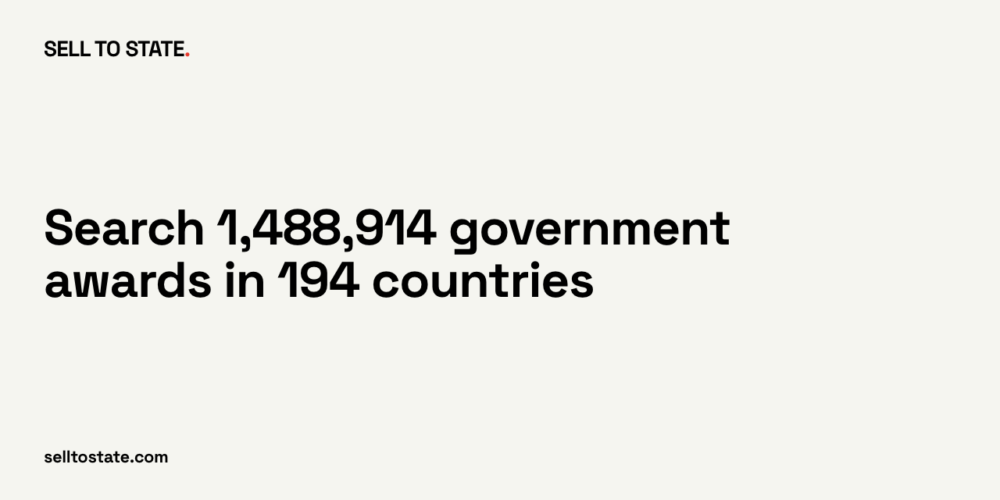

# Sell to State MCP server



Stdio proxy. It forwards JSON-RPC to `https://app.selltostate.com/api/mcp`. It does not keep a tool catalog and it does not talk to a database.

Set `STS_API_KEY`. A missing key fails `tools/call` before the network call.

```json
{
  "mcpServers": {
    "selltostate": {
      "command": "npx",
      "args": ["-y", "selltostate-mcp"],
      "env": { "STS_API_KEY": "sts_..." }
    }
  }
}
```

Use this server for a client that runs only local (stdio) servers, or when you prefer an API key to OAuth. A client that supports remote servers (Claude, ChatGPT, Cursor, VS Code, Gemini CLI) can connect to `https://app.selltostate.com/api/mcp` directly and sign in with OAuth. Setup per client: https://www.selltostate.com/mcp/

Transport: stdio, one JSON-RPC message per line. `STS_MCP_URL` changes the upstream URL.

## Also

- Site: [https://www.selltostate.com/?utm_source=github&utm_medium=referral&utm_campaign=sts-public-repos&utm_content=selltostate-mcp](https://www.selltostate.com/?utm_source=github&utm_medium=referral&utm_campaign=sts-public-repos&utm_content=selltostate-mcp)
- Countries: [https://www.selltostate.com/countries?utm_source=github&utm_medium=referral&utm_campaign=sts-public-repos&utm_content=selltostate-mcp](https://www.selltostate.com/countries?utm_source=github&utm_medium=referral&utm_campaign=sts-public-repos&utm_content=selltostate-mcp)
- Docs: [https://docs.selltostate.com/?utm_source=github&utm_medium=referral&utm_campaign=sts-public-repos&utm_content=selltostate-mcp](https://docs.selltostate.com/?utm_source=github&utm_medium=referral&utm_campaign=sts-public-repos&utm_content=selltostate-mcp)
- API keys: [https://app.selltostate.com/account/keys?utm_source=github&utm_medium=referral&utm_campaign=sts-public-repos&utm_content=selltostate-mcp](https://app.selltostate.com/account/keys?utm_source=github&utm_medium=referral&utm_campaign=sts-public-repos&utm_content=selltostate-mcp)
- X: https://x.com/selltostate
- https://github.com/getbeton/selltostate-api-reference
- https://github.com/getbeton/selltostate-mcp
- https://github.com/getbeton/selltostate-cli
- https://github.com/getbeton/selltostate-ts
- https://github.com/getbeton/selltostate-py
- https://github.com/getbeton/selltostate-java
- https://github.com/getbeton/selltostate-kotlin
- https://github.com/getbeton/selltostate-rust
- https://github.com/getbeton/selltostate-ror
- https://github.com/getbeton/selltostate-js
- https://github.com/getbeton/selltostate-node
- https://github.com/getbeton/selltostate-next

npm: [`selltostate-mcp`](https://www.npmjs.com/package/selltostate-mcp). The other clients in the list are not published to a package registry.
